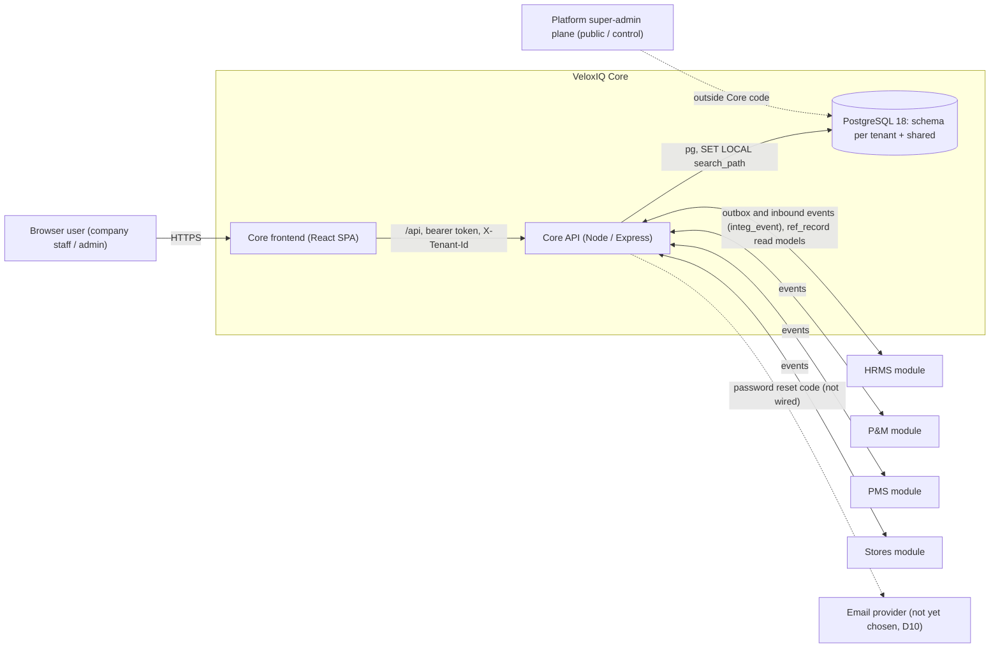
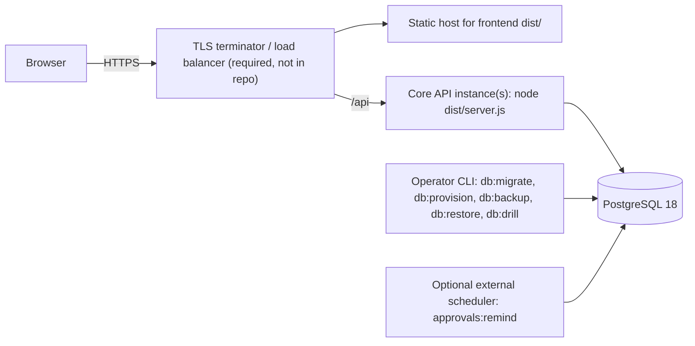

# VeloxIQ Core: System Architecture

| Field | Value |
|---|---|
| Document ID | DOC-02 |
| Title | System Architecture (high-level and low-level design) |
| Version | 1.0 |
| Date | 2026-11-25 |
| Status | Draft for review |
| Owner | To be confirmed |
| Classification | Internal |

## 1. Purpose

This document describes how VeloxIQ Core is built: its context, components, request handling, multi-tenancy, authentication, frontend, deployment as implemented, and the decisions behind them. It is written from the repository as it stands (API v1, version 1.10.0) and is meant for architects, developers, reviewers and operators.

## 2. Scope

In scope: the Core backend (`CORE__BACKEND`) and the Core frontend (`CORE__FRONTEND`). Out of scope: the HRMS, P&M, PMS and Stores modules (described only at their integration boundary), and the platform super-admin plane (`public`, `control` schemas), which Core code does not use (`CORE__BACKEND/Core_Database_Handoff.md`, section 1).

Related documents (not repeated here):

| Topic | Document |
|---|---|
| Frontend module rules | `CORE__FRONTEND/docs/ARCHITECTURE.md` |
| Frontend data model | `CORE__FRONTEND/docs/data-model.md` |
| Non-functional notes | `CORE__FRONTEND/docs/non-functional.md` |
| Deployment and operations | `CORE__BACKEND/docs/DEPLOYMENT.md` |
| API contract (279 operations, 1.10.0) | `CORE__BACKEND/docs/API_V1.md` |
| Frontend integration guide | `CORE__BACKEND/docs/frontend-handoff.md` |
| Data architecture | `docs/03-Data-Architecture-and-Governance.md` (DOC-03) |

## 3. System context

VeloxIQ Core is the shared foundation of the VeloxIQ ERP. It holds the company, organisation, projects, locations, stores, master data, users and access, policies, approvals, audit, files and the integration services. Other modules read Core tables but change them only through the Core API (`Core_Database_Handoff.md`, section 1).

| External party | Interaction | Source |
|---|---|---|
| Other ERP modules | Inbound events stored as read models in `ref_record` (source modules `hrms`, `pm`, `pms`, `stores`); outbound events via the outbox in `integ_event`, sent by the relay | `migrations/0040_ref_records.sql`, `src/core/relay.ts`, `src/core/events.ts`, `src/modules/integration/` |
| Email provider | Not chosen (decision D10). Non-production uses a fixed sample code; production answers 503 on password-reset request until a provider is wired | `src/config/env.ts`, `docs/DEPLOYMENT.md` |
| Load balancer / TLS terminator | Expected in front of the API; `TRUST_PROXY` lists the addresses allowed to set `X-Forwarded-For` | `src/config/trust-proxy.ts`, `docs/DEPLOYMENT.md` |

## 4. Logical components

| Layer | Component | Responsibility |
|---|---|---|
| Presentation | React SPA | Screens, client validation, session handling, unsaved-change guards |
| API edge | HTTP layer (`src/http/app.ts`), plugins | Routing, body parsing, security headers, CORS, rate limiting, OpenAPI, docs |
| Application | Feature modules (`src/modules/*`) | Routes, request schemas (Zod), services, rules, repositories |
| Cross-cutting core | `src/core/*` | Errors, response envelope, validation, idempotency, audit chain, redaction, events and relay, rate-limit store, password hashing |
| Data access | `src/db/*` | Pool, tenant transaction helper, migrations, backup/restore, restore drill, type generation |
| Storage | PostgreSQL 18 | Business data, audit chain, files (bytea), idempotency keys, outbox |
| Background work | Approval reminder sweep, outbox relay | Reminders (in-process timer or CLI); delivery of outbound events |

## 5. Backend module layout

| Path | Contents |
|---|---|
| `src/server.ts` | Process entry: loads env, creates pool, builds app, starts reminder schedule, handles SIGINT/SIGTERM (stop reminders, close app, end pool) |
| `src/app.ts` | `buildApp()`: registers plugins, error handler, health, offline and (when a pool exists) every module's routes |
| `src/http/app.ts` | Express 5 adapter exposing a small route API (`app.get(path, { onRequest, preHandler }, handler)`, hooks, `inject()` via light-my-request) |
| `src/config/` | `env.ts` (Zod-validated environment), `trust-proxy.ts` |
| `src/core/` | `audit.ts`, `canonical-json.ts`, `error-handler.ts`, `errors.ts`, `events.ts`, `relay.ts`, `health.ts`, `idempotency.ts`, `password.ts`, `rate-limit.ts`, `rate-limit-store.ts`, `redaction.ts`, `resource.ts` (generic CRUD with versioning, audit, idempotency), `response.ts`, `rows.ts`, `validation.ts`, `detail.ts`, `ranges.ts` |
| `src/db/` | `client.ts`, `tenant.ts`, `migrate.ts`, `cli.ts`, `backup*.ts`, `restore-drill*.ts`, `dev-user*.ts`, `types-gen.ts`, `types.generated.ts` |
| `src/plugins/` | `auth.ts` (guards), `security-headers.ts`, `cors.ts`, `rate-limit.ts`, `openapi.ts`, `api-docs.ts` |
| `src/modules/` | `access`, `approvals`, `audit-log`, `auth`, `boq`, `equipment-units`, `integration`, `maintenance`, `masters`, `offer-letter`, `offline`, `organisation`, `policies`, `projects`, `records`, `search`, `stock-levels`, `uoms` |

Modules follow a common shape: `routes.ts` (HTTP and guards), `schema.ts` (Zod input), `service.ts` (use cases), `rules.ts` (business rules), `repo.ts` or `resources.ts` (SQL). Not every module has every file (see the directory listing under `src/modules/`).

## 6. Request lifecycle

Order is stated in the header comment of `src/http/app.ts`.

| Step | What happens | Source |
|---|---|---|
| 1 | Global `onRequest` hooks: security headers, CORS preflight, global per-IP rate limit (600 requests/minute per client address; probes exempt) | `src/plugins/*`, `docs/DEPLOYMENT.md` |
| 2 | Route `onRequest` hooks (e.g. upload type check) before the body is read | `src/http/app.ts` |
| 3 | Body read and parsed within its size limit | `src/http/app.ts` |
| 4 | `preHandler`: `requireAuth` (bearer token verified, then live session read from the tenant schema, suspension and must-change-password checks), then `requireAccess(privilege, scope)` (live grants read on every request; 403 `ACCESS_DENIED`, refusal recorded in `core_auth_activity`), optional step-up | `src/plugins/auth.ts` |
| 5 | Handler runs in `withTenant`: one transaction, `SET LOCAL search_path` to `tenant_<id>` | `src/db/tenant.ts` |
| 6 | Writes: `Idempotency-Key` required on module POST/PATCH (400 `IDEMPOTENCY_KEY_REQUIRED`); `runIdempotent` stores request hash and response for 24 h; same key with a different body gives 409 `IDEMPOTENCY_KEY_REUSED` | `src/core/resource.ts`, `src/core/idempotency.ts` |
| 7 | Updates carry `rowVersion`; a stale value gives `VERSION_CONFLICT` | `src/core/resource.ts`, `src/core/rows.ts` |
| 8 | `appendAuditRow` in the same transaction as the change (INSERT/UPDATE/DELETE with redacted old and new snapshots) | `src/core/resource.ts`, `src/core/audit.ts` |
| 9 | Response envelope `{ data, meta? }`; errors `{ error: { code, message, details? } }`; `X-Request-Id` on every response | `src/core/response.ts`, `docs/DEPLOYMENT.md` |
| Error | One global handler: `AppError` messages and HTTP-layer 4xx messages pass; anything else becomes a generic 500 `INTERNAL_ERROR`, detail logged server-side only; unknown route is 404 `NOT_FOUND` | `src/core/error-handler.ts` |

Auth routes (`/auth/...`) and `POST /offline-operations` take no idempotency key; DELETE routes are unchanged (`docs/DEPLOYMENT.md`).

## 7. Multi-tenancy model

| Aspect | Implementation | Source |
|---|---|---|
| Isolation unit | One PostgreSQL database; one schema per tenant named `tenant_<id>`; tenant id must match `^[a-z][a-z0-9_]{0,39}$` | `src/db/migrate.ts` |
| Business tables | No `tenant_id` column; the schema is the boundary | `Core_Database_Handoff.md` section 1 |
| Shared data | `shared` schema (units of measure, read-only to Core); `public.core_rate_limit_window` for shared rate limiting; `citext` extension in `public` | `migrations/0000-0002*.sql` |
| Tenant on authenticated calls | Taken from the verified access token claims (`tenantId`), never from request input | `src/plugins/auth.ts`, `src/db/tenant.ts` |
| Tenant on pre-login calls | `X-Tenant-Id` header; `tenantExists()` check so an unknown tenant answers like an unknown login | `src/db/tenant.ts`, `src/modules/auth/routes.ts` |
| Connection safety | `SET LOCAL` inside a transaction, so a pooled connection never keeps a path between requests | `src/db/tenant.ts` |
| Serialisation within a tenant | `pg_advisory_xact_lock` keyed by schema and name (audit chain, idempotency) | `src/db/tenant.ts` |
| Known limit | A query may still name another tenant's schema explicitly; stopping that needs per-tenant database roles (not implemented) | comment in `src/db/tenant.ts` |
| Provisioning | `npm run db:provision -- <tenantId>` creates the schema and applies tenant migrations | `docs/DEPLOYMENT.md` |
| Frontend | Company chosen from the login ID prefix; sent as `X-Tenant-Id` on every call; no default company | `CORE__FRONTEND/src/shared/lib/api.ts` |

## 8. Authentication and authorisation summary

| Topic | Behaviour | Source |
|---|---|---|
| Login | Login ID plus password (argon2id via `hash-wasm`); lockout fields on `core_user`; login limited per IP and per login ID | `src/core/password.ts`, `src/modules/auth/routes.ts` |
| Tokens | Access token HS256 JWT (`jose`), 15 minutes; refresh token 30 days, rotated on refresh (only a hash is stored); signing key from `JWT_SECRET` (required in production, at least 32 characters) | `src/modules/auth/tokens.ts`, `src/config/env.ts` |
| Sessions | Server-side session row checked on every request, so logout or revoke takes effect immediately; `SESSION_DEVICE_LIMIT` default 1 (a new sign-in ends the other session) | `src/plugins/auth.ts`, `src/config/env.ts` |
| Passkeys | WebAuthn via `@simplewebauthn/server`; relying party from `WEBAUTHN_RP_ID` and `WEBAUTHN_ORIGINS` (required in production) | `src/modules/auth/passkey.ts` |
| Step-up | Short-lived step-up token (5 minutes) sent in `X-Step-Up-Token` for sensitive actions; may be obtained by passkey assertion | `src/modules/auth/step-up.ts` |
| Password reset | Email OTP flow; OTP stored only as a hash with expiry; sample code outside production only | `src/modules/auth/password-reset.ts`, `src/modules/auth/email-otp.ts` |
| Temporary password | `must_change_password` blocks protected routes except change password, read self and sign out (403 `PASSWORD_CHANGE_REQUIRED`) | `src/plugins/auth.ts` |
| Authorisation | Privilege grants in `core_user_access` with scope dimensions location, project, store (null = not constrained); evaluated on every request; suspension denies from the next request | `src/modules/access/policy.ts`, `src/modules/access/service.ts` |

## 9. Frontend architecture

Detail is in `CORE__FRONTEND/docs/ARCHITECTURE.md`; the summary below is checked against `src/`.

| Concern | Implementation | Source |
|---|---|---|
| Style | Modular monolith SPA; feature modules with a public `index.ts`; `app -> modules -> shared`; rules enforced by ESLint and dependency-cruiser | `docs/ARCHITECTURE.md` |
| Modules | `approvals`, `audit`, `auth`, `company`, `core-data`, `dashboard`, `grievances`, `integrations`, `organisation`, `projects`, `resources`, `shell`, `support` | `src/modules/` |
| Routing | `react-router-dom`; each module's `routes.ts` lazy-loads pages; `app/routes.ts` concatenates them; the sign-in screen is rendered by the auth gate in `App.tsx` | `src/app/` |
| State | `zustand`: `useAuth` (persisted to sessionStorage) and `useCore` (domain store in `core-data`) | `src/modules/auth/store/useAuth.ts`, `src/modules/core-data/store/useCore.ts` |
| API layer | `shared/lib/api.ts`: base `/api`; sends `X-Tenant-Id` and a fresh `X-Request-Id`; bearer access token held in memory; refresh token in sessionStorage; one refresh and retry on 401; `Idempotency-Key` (new UUID per action) on POST and PATCH; request timeout; typed `ApiError` carrying request id and `Retry-After` | `src/shared/lib/api.ts` |
| Step-up UI | Prompt component for step-up | `src/shared/lib/stepUp.tsx` |
| Guarded forms | `useGuardedForm` wraps react-hook-form, reports dirty state to a page-level guard (`unsaved.ts`, `UnsavedChangesGuard`); not counted unsaved while submitting; reset after success | `src/shared/lib/useGuardedForm.ts` |
| UI kit | Tailwind CSS 4, Radix primitives, `cmdk`, `sonner`, `recharts`, `leaflet` | `package.json`, `src/shared/ui/` |
| Build | Vite, base `./` (portable); dev server proxies `/api` to the backend (`VITE_API_PROXY_TARGET`, default `http://127.0.0.1:3200`); bundle size check script | `vite.config.ts`, `package.json` |

## 10. Deployment topology as implemented

The repository contains no container files, infrastructure-as-code or CI pipeline definitions; hosting vendor and environments are To be confirmed. What the code and `docs/DEPLOYMENT.md` define:

| Item | As implemented | Source |
|---|---|---|
| Backend runtime | Node 24 or later (`engines`), `npm run build` (tsc) then `npm start` (`dist/server.js`) | `CORE__BACKEND/package.json` |
| Frontend delivery | Static build in `dist/`; `/api` must be routed to the API (same-origin) or `VITE_API_BASE_URL` set with `CORS_ORIGINS` on the API | `vite.config.ts`, `src/shared/lib/api.ts` |
| Probes | `GET /health` (liveness), `GET /health/ready` (database `SELECT 1`) | `src/core/health.ts`, `docs/DEPLOYMENT.md` |
| Scaling | Several instances are supported: rate limits shared through PostgreSQL; reminders lock each request; relay locks each event (`SKIP LOCKED`) | `src/core/rate-limit-store.ts`, `src/core/relay.ts` |
| Database role | Application should use the `core_app` role, not the owner (`scripts/admin/create-core-app-role.sql`); marked an open item in `DEPLOYMENT.md` | `docs/DEPLOYMENT.md` |
| Logs | JSON (pino 10) with redaction of credentials | `src/app.ts`, `src/core/redaction.ts` |
| Configuration | Environment variable names: `NODE_ENV`, `HOST`, `PORT`, `LOG_LEVEL`, `DATABASE_URL`, `JWT_SECRET`, `WEBAUTHN_RP_ID`, `WEBAUTHN_ORIGINS`, `CORS_ORIGINS`, `SESSION_DEVICE_LIMIT`, `APPROVAL_REMINDER_MINUTES`, `SAMPLE_OTP_CODE`, `TRUST_PROXY`, `PG_BIN` | `src/config/env.ts`, `docs/DEPLOYMENT.md` |
| Rollback | Redeploy previous build; migrations are forward-only; data restored per tenant from backup | `docs/DEPLOYMENT.md` |
| Restore evidence | Drill reports dated 2026-11-21 for two tenants (acme: PASSED) | `CORE__BACKEND/docs/restore-drills/` |

## 11. Key design decisions (ADR log)

| ID | Decision | Status |
|---|---|---|
| ADR-01 | Schema-per-tenant in one PostgreSQL database, no `tenant_id` on business tables | Accepted |
| ADR-02 | Tenant context set per transaction with `SET LOCAL search_path` | Accepted |
| ADR-03 | Stateless JWT plus server-side session check on every request | Accepted |
| ADR-04 | Mandatory `Idempotency-Key` on writes, stored in the tenant schema | Accepted |
| ADR-05 | Optimistic locking with `row_version` | Accepted |
| ADR-06 | Hash-chained, append-only audit log written in the same transaction | Accepted |
| ADR-07 | Express 5 behind a thin route adapter | Accepted |
| ADR-08 | Locked API v1 with OpenAPI and regression tests | Accepted |
| ADR-09 | Transactional outbox and read models for module integration | Accepted |
| ADR-10 | Files stored in PostgreSQL (`core_file_content`, bytea) | Accepted |
| ADR-11 | Approval reminders, never escalation | Accepted |
| ADR-12 | Frontend as modular monolith with enforced boundaries | Accepted |
| ADR-13 | Forward-only migrations with checksums | Accepted |

### ADR-01 / ADR-02: Schema-per-tenant and SET LOCAL
Status: Accepted. Context: many companies share one deployment and must not see each other's data. Decision: each tenant has schema `tenant_<id>`; every request runs in a transaction whose search path is set with `SET LOCAL`. Rationale: strong logical separation, per-tenant backup and restore, no tenant filter to forget in queries; `SET LOCAL` cannot leak across pooled connections. Consequences: migrations run per schema; cross-tenant protection depends on code discipline until per-tenant roles exist. Source: `Core_Database_Handoff.md` s1, `src/db/tenant.ts`.

### ADR-03: JWT with live session check
Status: Accepted. Context: logout, revoke and suspension must take effect quickly. Decision: 15-minute HS256 access token, refresh rotation, and a session read on each request. Consequence: one tenant-schema read per protected request. Source: `src/plugins/auth.ts`, `src/modules/auth/tokens.ts`.

### ADR-04: Idempotency keys
Status: Accepted. Context: retries on poor networks (including offline use) must not duplicate writes. Decision: required key on POST/PATCH; request hash comparison; stored response replayed for 24 hours, with one-time secrets removed from the stored copy. Source: `src/core/idempotency.ts`, `src/core/resource.ts`.

### ADR-05: Optimistic locking
Status: Accepted. Decision: every table has `row_version`; updates must send the version; a stale write matches no row and returns `VERSION_CONFLICT`. Rationale: no lost updates without long locks. Source: `src/core/rows.ts`.

### ADR-06: Hash-chained audit
Status: Accepted. Decision: each audit row stores `prev_hash` and `row_hash` (SHA-256 over canonical JSON); a trigger blocks UPDATE, DELETE and TRUNCATE; `verifyAuditChain` detects tampering by the table owner. Rationale: tamper evidence for company-control records. Source: `src/core/audit.ts`, `migrations/0002_audit_append_only.sql`.

### ADR-07 / ADR-08: HTTP layer and locked contract
Status: Accepted. Decision: Express 5 with an adapter keeping one route declaration style and in-process `inject()` for tests; the public API is locked as v1 with an OpenAPI document (`GET /openapi.json`) and regression suites (`npm run test:regression`). Rationale: stable contract for the frontend and other modules. Source: `src/http/app.ts`, `docs/API_V1.md`, `package.json`.

### ADR-09: Outbox and read models
Status: Accepted. Decision: outbound events are written to `integ_event` in the business transaction and sent by a relay with a retry policy; inbound events from other modules update `ref_record` ordered by aggregate sequence; `integ_offline_operation` supports offline submissions. Rationale: reliable integration without distributed transactions. Note: the relay does not start without a retry policy from the environment (`src/core/relay.ts`); transport is To be confirmed. Source: `src/core/events.ts`, `src/core/relay.ts`, `migrations/0039`, `0040`.

### ADR-10: Files in the database
Status: Accepted. Decision: file metadata in `core_file`, bytes in `core_file_content` (one row per file, cascade delete). Rationale: one backup and one consistency boundary per tenant. Consequence: database size grows with files; object storage is a possible later change (`core_file.object_key` exists). Source: `migrations/0015_file_content.sql`.

### ADR-11: Reminders only
Status: Accepted. Decision (owner decision D9): remind the approver every `APPROVAL_REMINDER_MINUTES` (default 15); never escalate. Source: `src/config/env.ts`, `src/modules/approvals/reminders.ts`.

### ADR-12: Frontend modular monolith
Status: Accepted. Decision: feature modules with public barrels, enforced by lint and dependency-cruiser. Source: `CORE__FRONTEND/docs/ARCHITECTURE.md`.

### ADR-13: Forward-only checksummed migrations
Status: Accepted. Decision: each migration is applied in one transaction and recorded in `core_migration` with a SHA-256 checksum; a changed file is refused; no automatic down migrations. Source: `src/db/migrate.ts`, `docs/DEPLOYMENT.md`.

## 12. Technology stack

| Area | Technology | Version | Source |
|---|---|---|---|
| Runtime | Node.js | >= 24.0.0 | backend `package.json` engines |
| Language | TypeScript | 5.9.3 (backend), ^6.0.3 (frontend) | package.json files |
| Web framework | Express | 5.2.1 | backend |
| Database | PostgreSQL | 18 | `docs/DEPLOYMENT.md` |
| DB driver | pg | 8.23.1 | backend |
| Validation | Zod | 4.6.7 (backend), ^4.6.7 (frontend) | package.json files |
| Auth libraries | jose 6.2.15, @simplewebauthn/server 14.0.3, hash-wasm 4.12.0 (argon2id) | as listed | backend |
| Logging | pino | 10.4.0 | backend |
| Test | vitest 5.1.1 (backend), ^5.0.5 (frontend); light-my-request 6.8.1 | as listed | package.json files |
| Lint/format | ESLint 10.15.0, typescript-eslint 8.73.0, Prettier 3.10.1 | backend | backend |
| Frontend | React ^19.3.1, react-router-dom ^7.18.4, zustand ^5.0.16, react-hook-form ^7.90.0 | as listed | frontend |
| Frontend build/UI | Vite ^8.3.5, Tailwind CSS ^4.3.3, Radix UI, recharts ^3.10.1, leaflet ^1.9.4, gsap ^3.15.0 | as listed | frontend |
| Frontend QA | Testing Library, jsdom ^29.1.1, axe-core 4.10.3, dependency-cruiser ^18.7.2 | as listed | frontend |

## 13. Quality attributes

| Attribute | How it is addressed | Evidence |
|---|---|---|
| Security | argon2id hashing, passkeys, step-up, security headers, CORS allow-list, rate limits, log and audit redaction, generic 500s | `src/plugins/`, `src/core/redaction.ts` |
| Integrity | Constraints, `row_version`, idempotency, one transaction per request | migrations, `src/core/` |
| Auditability | Hash-chained append-only audit, `core_auth_activity` | `src/core/audit.ts` |
| Availability | Liveness and readiness probes, multi-instance-safe components; availability target To be confirmed | `src/core/health.ts` |
| Recoverability | Per-tenant dump and restore, restore drill with audit-chain check; RPO/RTO targets To be confirmed (drill reports measured restore time) | `src/db/backup.ts`, `src/db/restore-drill.ts` |
| Maintainability | Modular layout, generated DB types (`db:types`), lint, type check, dependency rules | `package.json` |
| Testability | In-process `inject()`, regression suites for API lock, masters, identity | `package.json` |
| Observability | Structured logs with `X-Request-Id` correlation; no metrics or tracing stack found in the repository | `docs/DEPLOYMENT.md` |
| Accessibility | Audit document and axe-core in frontend dev dependencies | `CORE__FRONTEND/docs/ACCESSIBILITY_AUDIT.md` |
| Performance | Hot-path indexes (migration 0033); `load:baseline` script; numeric targets To be confirmed | `migrations/0033_hot_path_indexes.sql`, `scripts/load-baseline.ts` |

## 14. Constraints and assumptions

| Type | Statement | Source |
|---|---|---|
| Constraint | API v1 is locked; changes follow the versioning in `API_V1.md` | `docs/API_V1.md` |
| Constraint | TLS must terminate in front of the API; HSTS only in production | `docs/DEPLOYMENT.md` |
| Constraint | Production requires `JWT_SECRET`, `WEBAUTHN_RP_ID`, `WEBAUTHN_ORIGINS`; `SAMPLE_OTP_CODE` is refused | `src/config/env.ts` |
| Constraint | Schema changes are forward-only | `docs/DEPLOYMENT.md` |
| Constraint | `pg_dump` and `pg_restore` must match or exceed PostgreSQL 18 | `docs/DEPLOYMENT.md` |
| Assumption | Other modules change Core data only via the Core API | `Core_Database_Handoff.md` |
| Assumption | A real email provider will be chosen before production password reset is used | `docs/DEPLOYMENT.md` (D10) |
| Assumption | One active device session per user unless the owner changes `SESSION_DEVICE_LIMIT` | `src/config/env.ts` |

## 15. Open items

| # | Item | Status |
|---|---|---|
| 1 | Document owner and approvers | To be confirmed |
| 2 | Hosting vendor, environments, regions | To be confirmed |
| 3 | Container, IaC and CI/CD pipeline definitions (none in repository) | To be confirmed |
| 4 | Availability, RPO, RTO and performance targets (SLAs) | To be confirmed |
| 5 | Email provider for password reset (decision D10) | To be confirmed |
| 6 | Outbox relay transport and retry policy values | To be confirmed |
| 7 | `core_app` role creation confirmed before go-live | To be confirmed |
| 8 | Per-tenant database roles to block cross-schema access | To be confirmed |
| 9 | Monitoring, metrics and alerting stack | To be confirmed |
| 10 | Security certifications and penetration-test status | To be confirmed |

## 16. Revision history

| Version | Date | Author | Change |
|---|---|---|---|
| 1.0 | 2026-11-25 | To be confirmed | Initial draft from repository analysis |
