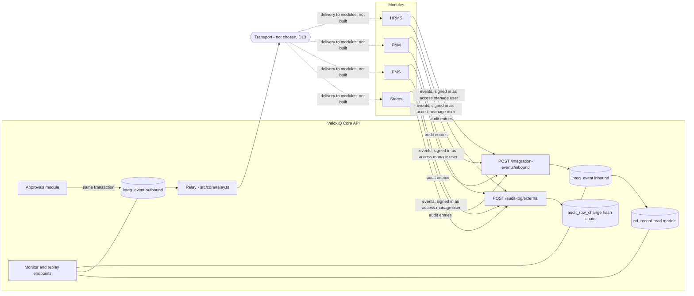

# Integration and Event Contract Specification

| Field | Value |
|---|---|
| Document ID | DOC-06 |
| Title | Integration and Event Contract Specification |
| Version | 1.0 |
| Date | 2026-11-25 |
| Status | Draft for review |
| Owner | To be confirmed |
| Classification | Internal |

## 1. Purpose

This document defines how VeloxIQ Core exchanges data and audit entries with the sibling modules HRMS, P&M, PMS and Stores. It is the contract a module team needs to send events to Core, receive events from Core, and send its own audit entries to Core.

## 2. Scope

| In scope | Out of scope |
|---|---|
| Event envelope, outbox and inbox, relay, replay, read models | Choice of production transport (open, decision D13) |
| Inbound events endpoint, replay endpoint, event monitor endpoints | Real module payload schemas (open, decision D15) |
| External audit endpoint `POST /audit-log/external` | Audit storage internals (see DOC-07) |
| Authentication model for calling modules | Module-internal design of HRMS, P&M, PMS, Stores |

Sources: `CORE__BACKEND/src/core/events.ts`, `src/core/relay.ts`, `src/modules/integration/{schema,routes,service}.ts`, `src/modules/audit-log/{schema,routes,service,repo}.ts`, `src/modules/approvals/service.ts`, migrations `0001_core_tenant.sql`, `0003_approved_constraints.sql`, `0039_event_relay.sql`, `0040_ref_records.sql`, `docs/API_V1.md` (1.10.0), `SCHEDULE-STATUS.md` (repo root).

Convention: "Core" is this application. Paths are relative to `CORE__V__0.4/CORE__BACKEND` unless stated.

## 3. Integration landscape



| Flow | Direction | Mechanism | State today |
|---|---|---|---|
| Module data into Core (employees, requests, stock and similar) | Module to Core | `POST /integration-events/inbound` into inbox, applied to `ref_record` | Built; payload formats open (D15) |
| Core decisions out to modules | Core to module | Outbox rows in `integ_event`, sent by relay through a `Publisher` | Outbox and relay built; no production publisher, and `src/server.ts` does not start the relay |
| Module activity into Core audit trail | Module to Core | `POST /audit-log/external` | Built |
| Operator diagnostics | Core internal | `GET /integration-events`, `/summary`, `/{id}`, `POST /{id}/replay`, `GET /ref-records`, `/ref-records/sync-status` | Built |

## 4. Event envelope

Table `integ_event` (migration 0001) stores both directions. Check constraints: `direction IN ('outbound','inbound')` (0001), `source_module IS NULL OR IN ('core','hrms','pm','pms','stores')` (0003), `replay_status IS NULL OR IN ('requested','replayed')` (0039). Unique index `(direction, event_id)` (0039).

### 4.1 Envelope fields (inbound request body)

Validated by `inboundEventBody` in `src/modules/integration/schema.ts`. The schema is `.strict()`: any field not listed is rejected with a validation error.

| Field | Type | Required | Rule |
|---|---|---|---|
| `eventId` | UUID | Yes | Unique per direction; the de-duplication identity of the event |
| `eventType` | string | Yes | 1 to 100 characters. A type ending `.deleted` marks the read-model copy deleted |
| `eventVersion` | string | Yes | 1 to 20 characters; version of the event contract |
| `schemaVersion` | string | Yes | 1 to 20 characters; version of the payload schema |
| `aggregateType` | string | Yes | 1 to 60 characters, `^[a-z_]+$`; becomes `entity_type` of the read model |
| `aggregateId` | UUID | Yes | Identity of the source record; becomes `source_id` |
| `aggregateSeq` | integer | Yes | At least 1; per-record sequence set by the producer |
| `occurredAt` | ISO 8601 datetime | Yes | When the change happened at the source |
| `sourceModule` | enum | Yes | `hrms`, `pm`, `pms`, `stores` |
| `correlationId` | string or null | No | 1 to 100 characters; if absent Core uses the request's `X-Request-Id` |
| `causationId` | UUID or null | No | Event that caused this one |
| `payload` | object | Yes | The record's fields as the module publishes them; unknown fields are kept |

### 4.2 Stored columns of `integ_event`

| Column | Meaning |
|---|---|
| `id` | Row id (UUID, internal) |
| `direction`, `status` | `outbound` or `inbound`; see section 6 |
| `event_id`, `event_type`, `event_version`, `schema_version` | Envelope identity and versions |
| `aggregate_type`, `aggregate_id`, `aggregate_seq` | Record identity and order |
| `occurred_at`, `correlation_id`, `causation_id`, `actor_id` | Time and tracing; `actor_id` references `core_user` |
| `payload` | JSON payload (never returned by the monitor; only key names) |
| `coalesce_key` | Column exists and is written; no code reads it for coalescing (To be confirmed) |
| `source_module` | Origin module; `core` for outbound |
| `attempts`, `last_error`, `next_attempt_at` | Retry state |
| `published_at`, `received_at`, `processed_at`, `dead_lettered_at` | Lifecycle timestamps |
| `replay_status`, `replayed_at` | `requested` then `replayed` |
| `created_at`, `updated_at`, `row_version` and similar | Standard row metadata |

Supporting table `integ_aggregate_sequence (aggregate_type, aggregate_id, last_seq)` provides outbound sequence numbers (`nextAggregateSeq` in `src/core/events.ts`): locked per aggregate, first value 1, gap-free.

## 5. Outbox and inbox pattern

| Aspect | Outbox (Core to modules) | Inbox (modules to Core) |
|---|---|---|
| Function | `enqueueOutbound` in `src/core/events.ts` | `recordInbound` then `applyInbound` (`src/modules/integration/service.ts`) |
| Transaction | Same transaction as the business change, so an event exists only if the change committed | Same transaction as recording, so an event is `processed` only if the read model was written |
| Sequence | Core assigns `aggregate_seq` per aggregate | Producer supplies `aggregateSeq` |
| Wake-up | `pg_notify('core_outbox', <tenant schema>)` on commit; relay also polls | Not applicable (synchronous) |
| Duplicate protection | Unique `(direction, event_id)` | Advisory lock `inbox:<eventId>`, existence check, then unique index |
| Initial status | `pending`, `attempts 0`, `next_attempt_at now()` | `received`, `attempts 0`, `received_at now()` |

## 6. Status model

Allowed values (`EVENT_STATUSES`, `src/modules/integration/schema.ts`): `pending`, `published`, `received`, `processed`, `dead_lettered`. The comment in `src/core/events.ts` calls these "working decisions"; no database check constraint exists on `status`.

| Direction | Transition | Trigger | Code |
|---|---|---|---|
| Outbound | (new) to `pending` | Business change commits | `enqueueOutbound` |
| Outbound | `pending` to `published` | Publisher returned without error | `relayTenant` |
| Outbound | `pending` to `pending` (attempts + 1) | Publisher threw, attempts below maximum | `relayTenant` |
| Outbound | `pending` to `dead_lettered` | Publisher threw and attempts reached maximum | `relayTenant` |
| Outbound | `dead_lettered` to `pending` | `POST /integration-events/{id}/replay` | `replayEvent` |
| Inbound | (new) to `received` | Event accepted | `recordInbound` |
| Inbound | `received` to `processed` | Applied to `ref_record`, or recognised as stale | `applyInbound` |
| Inbound | `dead_lettered` to `received` then `processed` | Replay | `replayEvent` |

No code path sets an inbound event to `dead_lettered` today: a failure inside the receive transaction rolls it back and the caller gets an error. Replay supports that state if it is set by other means.

## 7. Relay behaviour

Implementation: `src/core/relay.ts` (`relayTenant`, `startRelay`). Tests: `tests/integration/events.test.ts`.

| Topic | Behaviour |
|---|---|
| Delivery guarantee | At least once. Marked `published` only after `Publisher.publish` returns; a crash in between re-sends |
| Ordering | An event is sent only when it has the lowest `aggregate_seq` among that aggregate's outbound events still `pending` or `dead_lettered`. A dead-lettered event holds back later events of the same aggregate until it is replayed |
| Concurrency | One transaction per event; `FOR UPDATE SKIP LOCKED` prevents two relays sending the same event at once |
| Batch | Up to 50 events per tenant per run (default `batch` option) |
| Triggering | `LISTEN core_outbox` wakes the relay for the tenant that wrote; a poll of all tenants every `pollSeconds` is the fallback |
| Failure message | `safeError`: one line, trimmed, at most 500 characters, stored in `last_error` |
| Retry delay | `min(maxDelaySeconds, baseDelaySeconds x factor^(attempts-1))` |
| Dead letter | At `attempts >= maxAttempts`: status `dead_lettered`, `dead_lettered_at` set, error logged (`event dead-lettered`, fields tenant, eventId, eventType, error) |
| Message to publisher | `EventMessage`: id, tenant, eventId, eventType, eventVersion, schemaVersion, aggregateType, aggregateId, aggregateSeq, occurredAt, correlationId, causationId, actorId, sourceModule, payload |
| Publishers in the codebase | `MockPublisher` only (tests). No production publisher |
| Process wiring | `startRelay` is not called from `src/server.ts` (only the approval reminder schedule is started there) |

### 7.1 Retry policy configuration

`retryPolicyFrom` reads four environment variables and returns no policy if any is missing, empty or not a positive number. There are deliberately no defaults, and the relay does not start without a policy.

| Variable | Meaning |
|---|---|
| `EVENT_RETRY_MAX_ATTEMPTS` | Tries before dead-letter (rounded down) |
| `EVENT_RETRY_BASE_SECONDS` | First delay |
| `EVENT_RETRY_FACTOR` | Backoff multiplier |
| `EVENT_RETRY_MAX_DELAY_SECONDS` | Delay cap |

These names appear only in `src/core/relay.ts`; they are not declared in `src/config/env.ts` and nothing in `src/server.ts` or `src/app.ts` reads them.

### 7.2 Open decisions

Source: decision register in `SCHEDULE-STATUS.md` (repo root), status dated 2026-11-22. `CORE__BACKEND/PROGRESS.md` contains no D13 to D16 text. `DEFECTS.md` reuses the numbers D13 to D16 for unrelated defects, so always cite the register.

| Id | Decision | Status | Effect on this specification |
|---|---|---|---|
| D13 | Event transport (broker) | Open (owner) | Delivery of outbound events to modules cannot go live; inbound events use HTTP until decided. Source modules' own credentials are part of D13 (comment in `src/modules/integration/routes.ts`) |
| D14 | Event retry defaults (attempts, backoff, dead-letter) | Open (owner) | Relay will not start without the four variables above |
| D15 | Module payload fixtures (HRMS, P&M, Stores, PMS) | Open (owner) | Payload formats in section 12 are marked open; contract tests (CORE-24-08) use fictional payloads |
| D16 | Read-model freshness threshold | Open (owner) | Core shows last sync time only and marks nothing stale (`ReadModels.tsx`) |

## 8. Idempotency, duplicate and stale handling

`receiveInbound` in `src/modules/integration/service.ts`.

| Situation | Detection | Result | HTTP |
|---|---|---|---|
| New event | `(inbound, eventId)` not present | Stored `received`, applied, `processed` | 202, `outcome: applied` |
| Same `eventId` delivered again | Existing inbound row | Nothing stored or applied | 200, `outcome: duplicate` |
| Older or equal sequence for the same record | `ref_record.source_seq >= aggregateSeq` (check inside the upsert statement) | Event stored and marked `processed` with `last_error` "Stale: the read model already holds this or a newer version of the record"; read model unchanged | 202, `outcome: stale` |
| Newer sequence | `source_seq < aggregateSeq` | Read model overwritten, `row_version + 1` | 202, `outcome: applied` |
| `*.deleted` event type | Suffix test | `ref_record.deleted = true`, data replaced by payload | as above |
| Reference to a record Core does not hold | Not validated | Kept as is (soft reference) | as above |
| Unknown payload fields | Not validated | Kept in `data` | as above |
| Gap in sequence (for example 1 then 3) | Not checked | Applied; no gap detection or buffering exists | 202 |
| Two deliveries racing | Advisory lock per `eventId`; sequence check inside the SQL statement | The older cannot overwrite the newer | n/a |

HTTP idempotency layer: `POST` and `PATCH` routes (including both integration POST endpoints and replay) go through `inTenant`, which requires an `Idempotency-Key` header (missing gives 400 `IDEMPOTENCY_KEY_REQUIRED`). A repeat of the same key and body replays the stored response for 24 hours, and the same key with a different body gives 409 `IDEMPOTENCY_KEY_REUSED` (`src/core/resource.ts`, `docs/DEPLOYMENT.md`). Callers should send a new `Idempotency-Key` per event and rely on `eventId` for business-level de-duplication.

## 9. Read models (`ref_record`)

Migration `0040_ref_records.sql`. Source modules never write these tables directly; rows change only through the inbox.

| Column | Meaning |
|---|---|
| `source_module` | `hrms`, `pm`, `pms`, `stores` (check constraint) |
| `entity_type` | From `aggregateType`, `^[a-z_]{1,60}$` |
| `source_id` | From `aggregateId` (UUID) |
| `source_seq` | `aggregate_seq` of the event the row came from, at least 1 |
| `event_id` | Event that produced the current copy |
| `data` | The payload, as JSON |
| `deleted` | True after a `*.deleted` event |
| `synced_at` | When Core applied the event |

Unique index `(source_module, entity_type, source_id)`: one copy per source record.

| Endpoint | Query parameters | Returns |
|---|---|---|
| `GET /ref-records` | `sourceModule`, `entityType`, `q` (text search over the data), `limit` (1 to 200, default 50), `offset` | Page of records with data, plus `total` |
| `GET /ref-records/sync-status` | none | Per module and entity: record count, newest sequence, last sync time |

UI: Activity log, tab "Shared records" (`CORE__FRONTEND/src/modules/integrations/pages/ReadModels.tsx`).

## 10. Endpoints

All integration endpoints require a bearer token whose user holds `access.manage` at company scope (`guardRoute(options, ACCESS_MANAGE)`). Responses use `{ data, meta? }`; errors use `{ error: { code, message, details? } }` (`src/core/response.ts`).

| Method and path | Purpose | Success | Notable errors |
|---|---|---|---|
| `POST /integration-events/inbound` | Deliver one event | 202 applied or stale; 200 duplicate. Body `{ data: { outcome, eventId } }` | 400 validation, 401, 403 `ACCESS_DENIED` |
| `POST /integration-events/{id}/replay` | Re-send a dead-lettered event. Body `{}` (strict) | 200 with the event summary | 404 `INTEGRATION_EVENT_NOT_FOUND`; 409 `INTEGRATION_EVENT_NOT_REPLAYABLE` (status is not `dead_lettered`) |
| `GET /integration-events` | List, newest first. Filters `direction`, `status`, `eventType`, `from`, `to` (dates), `limit` (max 200), `offset` | 200 with `total` | 400 if `from` is after `to` |
| `GET /integration-events/summary` | Counts per direction and status, `oldestPendingAt`, `deadLettered` | 200 | |
| `GET /integration-events/{id}` | One event summary | 200 | 404 |
| `POST /audit-log/external` | One module audit entry (section 11) | 201 `{ id, module }` | 400, 401, 403 |

The monitor never returns payload values, only `payloadKeys` (sorted field names), so personal or commercial data in an event is not shown to administrators. Replay: an outbound event goes back to `pending` with `attempts 0` and `replay_status requested`, and the relay is signalled; an inbound event is set to `received` and applied again at once. Replay is audited (`auditWrite` on table `integ_event`, UPDATE with before and after snapshots).

## 11. External audit endpoint and sign-in convention

Schema `externalAuditBody` (`src/modules/audit-log/schema.ts`), strict.

| Field | Type | Required | Rule |
|---|---|---|---|
| `sourceModule` | enum | Yes | `hrms`, `pm`, `pms`, `stores` |
| `action` | string | Yes | 1 to 40, `^[a-z_]+$`, for example `signed_in` |
| `entityType` | string | Yes | 1 to 60, `^[a-z_]+$`, for example `leave_request`; stored as the audit table name |
| `recordRef` | string or null | No | 1 to 100; stored as record id, `-` when absent |
| `actorName` | string | Yes | 1 to 200 |
| `actorLogin` | string or null | No | 1 to 100 |
| `summary` | string | Yes | 1 to 300; the sentence a reader sees |
| `occurredAt` | ISO 8601 datetime | Yes | Time at the module |
| `correlationId` | string or null | No | 1 to 100; Core's request id is used when absent |
| `details` | object or null | No | Extra fields kept with the entry; sensitive keys redacted (DOC-07) |

Storage (`recordExternalAudit`, `src/modules/audit-log/service.ts`): one `audit_row_change` row, `op INSERT`, `module_name` = `sourceModule`, `actor_id` NULL (the person named is not a Core user), `new_row` holding details plus `summary`, `action`, `actorName`, `actorLogin`, `occurredAt`. It joins the same hash chain as Core's own entries.

Sign-in convention (`src/modules/audit-log/repo.ts`, `docs/API_V1.md` 1.10.0): an entry with `entityType` = `session` also appears in the Sign-ins list. `action` values `signed_in`, `signed_out`, `login_failed` are shown as `login_success`, `logout`, `login_failure`. Any other action is shown there only if it equals one of the listed `AUTH_EVENT_TYPES`; otherwise it appears in the Activity list but not in Sign-ins.

## 12. Events produced and payload formats

### 12.1 Outbound events produced today

Only the approvals module enqueues outbound events (`enqueueOutbound` is called only from `emitRequestEvent` in `src/modules/approvals/service.ts`).

| Event type | When | aggregateType | eventVersion / schemaVersion | sourceModule |
|---|---|---|---|---|
| `approval_request.raised` | A request is raised | `approval_request` | `1` / `1` | `core` |
| `approval_request.decided` | An approver or raiser acts on a request. Action values: `approve`, `reject`, `return`, `cancel`, `clarify`, `respond` | `approval_request` | `1` / `1` | `core` |

Payload: `requestId`, `code`, `requestType`, `module`, `status`, `currentLevel`, and for decisions `action`, `actedAtLevel`. Comments, decision text and the request payload are deliberately excluded. `correlationId` is the originating request id; `actorId` is the acting user.

### 12.2 Per-module responsibilities

| Module | Must send to Core | Must receive from Core | Payload format |
|---|---|---|---|
| HRMS | Inbound events for employee and related records (aggregate types to be agreed) using the envelope in section 4; sign-in and other audit entries via `POST /audit-log/external` | `approval_request.*` events relevant to HRMS requests (`module` field in payload) | Open (D15) |
| P&M | Inbound events for its records; audit entries | As above | Open (D15) |
| PMS | Inbound events for its records (for example requests); audit entries, for example "request raised" | As above | Open (D15) |
| Stores | Inbound events for its records; audit entries | As above | Open (D15) |
| All | A unique `eventId` and strictly increasing `aggregateSeq` per record; a stable `aggregateId` UUID; `Idempotency-Key` on every POST | Delivery mechanism | Transport open (D13) |

Which request types each module raises and which `module` values appear in the approvals payload come from approvals configuration (`core_approval_request.module`); the value list is To be confirmed with the module owners.

## 13. Authentication model for calling modules

| Item | Fact | Source |
|---|---|---|
| Identity | A module calls as a Core user. Routes need a bearer token and the `access.manage` privilege at company scope; there is no separate service credential or signature scheme | `src/modules/integration/routes.ts`, `src/modules/audit-log/routes.ts` comments |
| Sign-in | `POST /auth/login` with header `X-Tenant-Id` and body `loginId`, `password`, optional `deviceLabel` | `src/modules/auth/routes.ts`, `schema.ts` |
| Access token | Lifetime 15 minutes | `ACCESS_TOKEN_TTL_SECONDS`, `src/modules/auth/tokens.ts` |
| Refresh | `POST /auth/refresh` with the refresh token; lifetime 30 days; reuse of an old refresh token revokes the session | `REFRESH_TOKEN_TTL_MS`, `docs/frontend-handoff.md` |
| Tenant | Taken from the token; all work runs in that tenant's schema (`withTenant`) | `src/core/resource.ts` |
| Refusal | Missing privilege answers 403 `ACCESS_DENIED` and records an `access_denied` sign-in event | `src/plugins/auth.ts` |
| Rate limits | Global 600 requests per minute per client address; tighter on login | `docs/DEPLOYMENT.md` |
| Limitations | A dedicated machine identity, key rotation and per-module credentials are not implemented; the routes comment ties them to D13 | `src/modules/integration/routes.ts` |

Proposed (not implemented): one named integration user per module holding only `access.manage`, its password in the module's secret manager, and token refresh instead of signing in per call. Whether a narrower privilege than `access.manage` should be introduced is To be confirmed.

## 14. Error handling

| Case | Response | Caller action |
|---|---|---|
| Schema or field violation | 400 with details | Fix payload; do not retry unchanged |
| Missing `Idempotency-Key` | 400 `IDEMPOTENCY_KEY_REQUIRED` | Add header |
| Same key, different body | 409 `IDEMPOTENCY_KEY_REUSED` | New key |
| Token missing or expired | 401 `AUTH_REQUIRED` | Refresh or sign in, retry |
| Lacks privilege | 403 `ACCESS_DENIED` | Fix grant |
| Rate limit | 429 with `Retry-After` | Wait, retry |
| Replay of a non-dead-lettered event | 409 `INTEGRATION_EVENT_NOT_REPLAYABLE` | None |
| Unknown event id | 404 `INTEGRATION_EVENT_NOT_FOUND` | None |
| Server error | 500 `INTERNAL_ERROR`; detail logged server-side only (`src/core/error-handler.ts`) | Retry with the same `Idempotency-Key` and `eventId` |
| Database unreachable | Pool connection fails after 5 seconds (DEFECTS.md, defect D14, `src/db/client.ts`) | Retry with back-off |

Every response carries `X-Request-Id`; quote it in support requests (see DOC-07).

## 15. Versioning rules

| Item | Rule today | Evidence |
|---|---|---|
| `eventVersion` | Free string up to 20 characters; Core stores it and does not branch on it. Outbound is `1` | `schema.ts`, `approvals/service.ts` |
| `schemaVersion` | Free string up to 20 characters; stored; outbound is `1` | as above |
| Compatibility | Unknown payload fields are kept, so additive changes do not break the inbox. Version mismatches are not rejected | `receiveInbound` comment |
| REST contract | Locked at `docs/api/openapi-v1.json`; changelog in `docs/API_V1.md`; current 1.10.0 | `docs/API_V1.md` |
| Rules for bumping versions, deprecation windows, consumer version negotiation | Not defined in the repository | To be confirmed |

Proposed rules (not adopted): add optional fields without a version change; bump `schemaVersion` for any removed, renamed or re-typed field; bump `eventVersion` when the envelope meaning changes; support the previous version for a period to be agreed.

## 16. Worked examples (fictional data)

All names, identifiers and codes below are invented.

### 16.1 Inbound employee event (HRMS to Core)

Request: `POST /integration-events/inbound` with headers `Authorization: Bearer <token>`, `Idempotency-Key: <new unique value>`, `Content-Type: application/json`. The payload fields are illustrative only; the real format is open (D15).

```json
{
  "eventId": "0b6f2a8e-3c41-4d7a-9a52-1f0c7e5d1a01",
  "eventType": "employee.updated",
  "eventVersion": "1",
  "schemaVersion": "1",
  "aggregateType": "employee",
  "aggregateId": "7c9e6679-7425-40de-944b-e07fc1f90ae7",
  "aggregateSeq": 4,
  "occurredAt": "2026-11-25T09:30:00.000Z",
  "sourceModule": "hrms",
  "correlationId": "hrms-req-000123",
  "causationId": null,
  "payload": {
    "employeeCode": "EMP-0001",
    "name": "Sample Employee",
    "department": "Civil",
    "status": "active"
  }
}
```

Response 202: `{ "data": { "outcome": "applied", "eventId": "0b6f2a8e-3c41-4d7a-9a52-1f0c7e5d1a01" } }`. Sending the same `eventId` again returns 200 with `"outcome": "duplicate"`; a later event for the same record with `aggregateSeq` 3 returns 202 with `"outcome": "stale"`.

### 16.2 Outbound approval-decided event (Core to modules)

As handed to a publisher (`EventMessage`); `payload` fields are those of `emitRequestEvent`.

```json
{
  "id": "a1b2c3d4-0000-4000-8000-00000000aa01",
  "tenant": "acme",
  "eventId": "e5f6a7b8-1111-4222-8333-444455556666",
  "eventType": "approval_request.decided",
  "eventVersion": "1",
  "schemaVersion": "1",
  "aggregateType": "approval_request",
  "aggregateId": "3f2b8c1d-9e7a-4b6c-8d5e-0a1b2c3d4e5f",
  "aggregateSeq": 2,
  "occurredAt": "2026-11-25T10:05:12.000Z",
  "correlationId": "req-2k9",
  "causationId": null,
  "actorId": "9d8c7b6a-1234-4abc-9def-0123456789ab",
  "sourceModule": "core",
  "payload": {
    "requestId": "3f2b8c1d-9e7a-4b6c-8d5e-0a1b2c3d4e5f",
    "code": "REQ-0001",
    "requestType": "sample_request",
    "module": "pms",
    "status": "approved",
    "currentLevel": 1,
    "action": "approve",
    "actedAtLevel": 1
  }
}
```

The `tenant`, `requestType` and `module` values are illustrative; the real status list is in `src/modules/approvals/schema.ts`.

### 16.3 External audit entry (HRMS sign-in)

Request: `POST /audit-log/external`, with an `Idempotency-Key` header.

```json
{
  "sourceModule": "hrms",
  "action": "signed_in",
  "entityType": "session",
  "recordRef": "session-0001",
  "actorName": "Sample User",
  "actorLogin": "sample.user",
  "summary": "Sample User signed in to HRMS",
  "occurredAt": "2026-11-25T08:00:00.000Z",
  "correlationId": "hrms-req-000124",
  "details": { "deviceLabel": "Office laptop" }
}
```

Response 201: `{ "data": { "id": "<audit entry uuid>", "module": "hrms" } }`. The entry appears in Activity and, because `entityType` is `session`, in Sign-ins as `login_success`.

### 16.4 External audit entry (PMS request raised)

```json
{
  "sourceModule": "pms",
  "action": "raised",
  "entityType": "purchase_request",
  "recordRef": "PR-0001",
  "actorName": "Sample Requester",
  "actorLogin": "sample.requester",
  "summary": "Sample Requester raised purchase request PR-0001",
  "occurredAt": "2026-11-25T08:15:00.000Z",
  "details": { "items": 3, "priority": "normal" }
}
```

The `entityType` value `purchase_request` is invented for this example; the real PMS record types are To be confirmed with the PMS team.

## 17. Consumer checklist

| # | Check | Done |
|---|---|---|
| 1 | Integration user exists in the right tenant and holds `access.manage` at company scope | |
| 2 | `X-Tenant-Id` sent at login; access token refreshed before its 15-minute expiry | |
| 3 | `Idempotency-Key` sent on every POST, new per event, reused only when retrying the same event | |
| 4 | Every event has a new UUID `eventId` and a stable `aggregateId` | |
| 5 | `aggregateSeq` starts at 1 per record and increases for every change; never reused | |
| 6 | `eventType` for deletions ends in `.deleted` | |
| 7 | `aggregateType` is lower-case with underscores only; `sourceModule` is one of `hrms`, `pm`, `pms`, `stores` | |
| 8 | No secrets, passwords, tokens or unneeded personal data in `payload` or `details` | |
| 9 | Treat 200 `duplicate` and 202 `stale` as success; retry on 429, 5xx and network errors with back-off | |
| 10 | Quote `X-Request-Id` and your `correlationId` in support requests | |
| 11 | Send sign-in, sign-out and failed sign-in as `entityType` `session` with action `signed_in`, `signed_out`, `login_failed` | |
| 12 | Contract test with fictional fixtures passes (module-approved fixtures open, D15) | |
| 13 | Consumers of Core events de-duplicate on `eventId` and apply by `aggregateSeq` (delivery is at least once) | |

## 18. Open items

| # | Item | Status |
|---|---|---|
| 1 | Production event transport (D13), including source modules' credentials | Open (owner) per `SCHEDULE-STATUS.md` |
| 2 | Retry values (D14); relay not started by `src/server.ts`; retry variables not declared in `src/config/env.ts` | Open (owner) |
| 3 | Module payload formats and fixtures (D15) | Open (owner) |
| 4 | Read-model freshness threshold (D16) | Open (owner) |
| 5 | Document owner and approval | To be confirmed |
| 6 | Whether a narrower privilege than `access.manage`, or a machine identity, is wanted for modules | To be confirmed |
| 7 | Event and schema version bump policy and deprecation window | To be confirmed |
| 8 | Handling of sequence gaps (none exists today) | To be confirmed |
| 9 | Use of `coalesce_key` (stored, not used by relay) | To be confirmed |
| 10 | Allowed `module` and `requestType` values per module in approval events | To be confirmed |
| 11 | Alerting on dead-lettered events and outbox lag (no target until D13; see DOC-07) | To be confirmed |
| 12 | `CORE__BACKEND/PROGRESS.md` holds no D13 to D16 text; the register used here is `SCHEDULE-STATUS.md` | Noted |

## 19. Revision history

| Version | Date | Author | Change |
|---|---|---|---|
| 1.0 | 2026-11-25 | To be confirmed | First draft from repository inspection |
